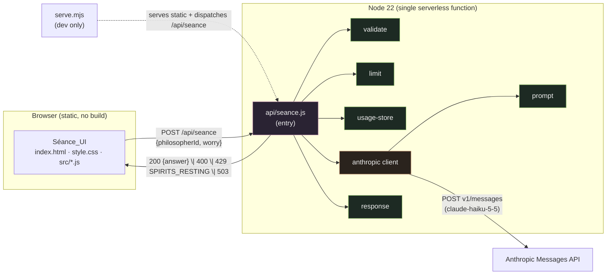
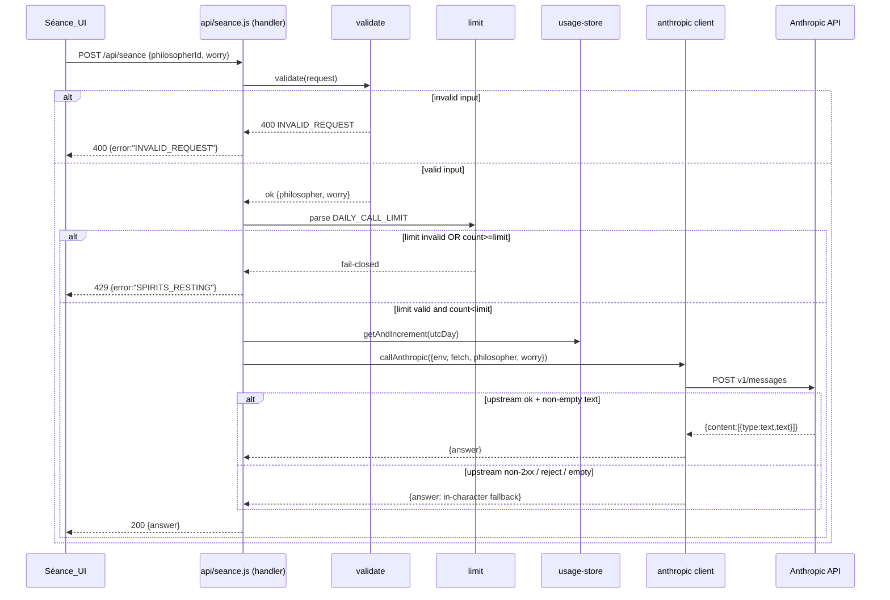

# Design Document — Philosophers' Séance (seance-core)

## Overview

Philosophers' Séance is a static, build-free web app styled as a candlelit Ouija board. A visitor summons one of six public-domain philosophers, types a personal worry, and the summoned spirit replies in character. The front end is plain HTML, CSS, and vanilla JavaScript served as static files. The back end is exactly one Node 22 serverless function (plain ESM, no web framework) that validates input at the trust boundary, enforces a per-UTC-day call cap with fail-closed defaults, and calls the Anthropic Messages API (`claude-haiku-5-5`).

This design covers the core séance experience for the Kiroween 2026 Costume Contest. Deployment to a serverless platform is out of scope for this phase; only a dependency-free local dev server is specified. Every design decision traces back to a requirement in `requirements.md`.

**Design goals:**
- A séance aesthetic that is eerie but kind — never hostile, never claiming real contact with the dead or professional counsel.
- Security by default: input validation at the trust boundary, secrets only from the environment, fail-closed rate limiting, no raw upstream errors leaking to the visitor.
- Testability through separation of pure logic from I/O and DOM, so the built-in `node:test` runner and a property-based testing library can exercise the logic without a browser or live API key.

### Research findings that inform the design

- **Anthropic Messages API** ([platform.claude.com/docs/en/api/messages](https://platform.claude.com/docs/en/api/messages)): the endpoint is `POST https://api.anthropic.com/v1/messages`. The request body is `{ model, max_tokens, system, messages: [{ role, content }] }`. The top-level `system` field accepts a plain string, so a single persona prompt needs no content-block array. A successful response is `{ content: [{ type: "text", text }], role: "assistant", stop_reason, ... }`; the answer is the `text` of the first block in `content` whose `type === "text"`. Required headers are `content-type: application/json`, `anthropic-version: <pinned version>`, and an auth header (`x-api-key` or `Authorization: Bearer`).
- **Node 22 runtime**: global `fetch`, `AbortController`, and the Web `Request`/`Response` types are available natively, so the serverless function and the dev server need no HTTP library. The `node:http`, `node:fs`, `node:path`, and `node:url` built-ins cover the dev server with zero runtime dependencies.
- **`prefers-reduced-motion`**: detected with `window.matchMedia('(prefers-reduced-motion: reduce)')`, which also emits `change` events so the UI can react if the visitor toggles the OS preference mid-session.

## Architecture

The app has two runtime tiers and a development convenience server.



- **Séance_UI** (browser) renders the board, candles, planchette, philosopher picker, worry input, counter, waiting indicator, and answer reveal. It talks to the back end only via `POST /api/seance` through a fetch client that owns a 30-second `AbortController` timeout.
- **Séance_API** (one serverless function) is the entry `api/seance.js`, composed of co-located private ESM modules under `api/`. It validates input, checks the daily limit, checks the API key, increments the usage count, calls Anthropic, and shapes the response. "Exactly one serverless function" means one entrypoint/deployment unit; the sibling modules are its private, unit-testable implementation.
- **serve.mjs** (dev only) is a Node-stdlib-only script that serves the static front end and dispatches `POST /api/seance` to the same handler the serverless platform would invoke. It is a development convenience, not a production target.

The handler is exposed as a factory `createHandler(deps)` returning `async (Request) => Response`, using the Web `Request`/`Response` types that are global in Node 22. `serve.mjs` bridges `node:http`'s `IncomingMessage`/`ServerResponse` to those types; a production platform adapter would do the same for its native request shape. This keeps the core logic framework-free and testable by constructing `new Request(...)` in tests.

### Request/response flow



### Design decisions and rationale

- **One function, internal modules.** `api/seance.js` is the single serverless entry; trust-boundary and counting logic live in pure sibling modules so each is test-first with one `*.test.js`. This satisfies "exactly one serverless function" (one entrypoint) while meeting the test-per-module rule.
- **DI seam for the store and fetch.** `createHandler({ env, store, fetch })` injects the usage store and the fetch implementation. The handler depends only on the `Usage_Store` interface, so a durable store can replace the in-memory one with no edit to request-handling logic. Injecting `fetch` lets tests mock Anthropic.
- **Precedence: 400 → 429 → 503 → increment → call.** Input is validated first (cheap, stateless, and it prevents malformed probes from consuming rate budget or surfacing rate internals). The fail-closed limit check precedes the key check so a misconfigured `DAILY_CALL_LIMIT` blocks every call with `SPIRITS_RESTING` regardless of key state. The count is incremented only when the call actually proceeds to Anthropic, and the increment is retained even if Anthropic later fails. The requirements do not mandate a total order across 400/429/503; this order is chosen and documented.
- **Front-end purity for testability.** Front-end logic that must hold universally (code-point counting, truncation, remaining count, planchette letter path, error→message mapping) is implemented as pure functions in `src/` modules with no top-level DOM access, so `node:test` can import and property-test them directly. DOM wiring lives in thin companion functions covered by example-based DOM tests.

## Components and Interfaces

### Front-end modules (`src/`)

| Module | Responsibility | Requirement |
|---|---|---|
| `src/main.js` | Entry orchestrator: wires DOM, holds app state (selected philosopher, worry, in-flight controller), delegates to other modules, manages focus order. | 1, 2, 3, 4, 9 |
| `src/board.js` | Renders the Ouija board (26 letters A–Z), the planchette element, and candle elements; sets ARIA role + accessible name on the board and planchette; marks candles decorative (`aria-hidden="true"`). | 1.1, 9.4 |
| `src/planchette.js` | Pure `planchettePath(name) → letters[]` (the name's letters in order) plus the glide (visit each letter in order, rest on the final, within 20s) and the reduced-motion instant transition to the final letter. | 1.2, 1.4 |
| `src/candle.js` | Candle flicker (CSS-driven brightness animation) and reduced-motion disable of the flicker. | 1.3, 1.4 |
| `src/philosophers.js` | The six philosophers' client data (`id`, `name`, display `persona`), the picker UI logic, and selection state (distinguish selected, deselect previous, enable worry). | 2.1–2.5, 12.3 |
| `src/worry.js` | Pure helpers `countCodePoints(str)`, `truncateToCodePoints(str, max)`, `remainingCount(str, max)`, `isTrimmedEmpty(str)` plus DOM wiring for the input, the 500-code-point bound, and the live counter. | 3.1–3.4 |
| `src/reveal.js` | Progressive spirit-writing reveal (characters in sequence, total ≤ 5s), reduced-motion instant reveal (within 16ms), the waiting indicator, and the live region that keeps the full answer text present and AT-readable throughout the reveal. | 4.1, 4.2, 4.4, 9.2, 9.5 |
| `src/api-client.js` | `summon({philosopherId, worry})` → `POST /api/seance` with a 30s `AbortController`; `cancelInFlight()` aborts the current controller on a new summon; `mapErrorToMessage(response)` maps any non-success to an in-character message and never exposes status/stack/model text. | 4.3, 4.5, 6.6, 10.2 |
| `src/reduced-motion.js` | Detects `prefers-reduced-motion: reduce`, broadcasts changes to `planchette`, `candle`, and `reveal`. | 1.4, 9.2 |

### Back-end modules (`api/`)

| Module | Responsibility | Requirement |
|---|---|---|
| `api/seance.js` | The single serverless function. Exports `createHandler({ env, store, fetch })` → `async (Request) => Response`. Orchestrates: validate → limit/key checks → increment → call Anthropic → shape response, applying the 400→429→503→increment→call precedence. | 5, 6, 7, 10, 11 |
| `api/validate.js` | Pure trust-boundary validation/sanitization. `parseAndValidate(request)` returns `{ ok, philosopher, worry }` or `{ status:400, code:"INVALID_REQUEST" }`. `sanitizeWorry(s)` removes ASCII control chars (U+0000–U+001F and U+007F) before trimming; checks non-empty and ≤ 500 code points after trimming. | 7 |
| `api/limit.js` | Pure `parseDailyCallLimit(value) → positiveInt \| null`. Returns `null` (fail-closed) for unset, empty, non-integer, or values less than one. | 6.2 |
| `api/usage-store.js` | The `Usage_Store` interface (`getCurrentCount(utcDay) → number`, `getAndIncrement(utcDay) → number`) and `InMemoryUsageStore` keyed by UTC day string. | 6.1, 6.5, 11 |
| `api/anthropic.js` | `callAnthropic({ env, fetch, philosopher, worry }) → { answer }`. Builds the payload (`model`, `max_tokens: 1024`, `system`, `messages`), posts to the pinned Anthropic endpoint with the key from `env`, extracts the first `text` block, and on any upstream failure returns an in-character fallback answer (no upstream detail). | 5.2, 5.3, 5.6, 10.1 |
| `api/prompt.js` | The six philosophers' prompt data (`id`, `name`, prompt `persona`) and `buildSystemPrompt(philosopher) → string`, composing the persona with the voice traits and the guardrail clauses (imagination framing; no real contact/prediction; decline medical/legal/financial/therapeutic advice and redirect to reflection). | 5.5, 12.5, 12.6 |
| `api/response.js` | JSON response helpers, error bodies (`SPIRITS_RESTING`, `INVALID_REQUEST`, `SPIRITS_UNREACHABLE`), and the in-character fallback messages; a `redact` helper used to ensure the key and full worry never appear in any log. | 4.3, 6.6, 7.5, 10.1 |

### Local dev server (`serve.mjs`)

A root-level Node-stdlib-only script (dev convenience, not production):
- `node:http` server listening on `process.env.PORT || 3000`.
- Serves static files (`index.html`, `style.css`, `src/`) from the project root via `node:fs`/`node:path`/`node:url`.
- Routes `POST /api/seance` to the handler: reads the request body, builds a Web `Request`, calls `createHandler({ env: process.env, store: new InMemoryUsageStore(), fetch: globalThis.fetch })(request)`, and writes the returned `Response` to the `ServerResponse`.
- Reads `ANTHROPIC_API_KEY` and `DAILY_CALL_LIMIT` from `process.env` only (no `.env` loader).
- Imports only `node:*` built-ins plus the local `api/seance.js` factory.

### Interfaces (contracts)

**Handler factory**
```ts
createHandler(deps: {
  env: { ANTHROPIC_API_KEY?: string; DAILY_CALL_LIMIT?: string },
  store: Usage_Store,            // injected; depends only on the interface
  fetch?: typeof fetch           // injectable; defaults to global fetch
}): (request: Request) => Promise<Response>
```

**`Usage_Store` interface**
```ts
interface Usage_Store {
  getCurrentCount(utcDay: string): number;   // accepted-call count for that UTC day
  getAndIncrement(utcDay: string): number;    // increment by one and return the new count
}
```
`utcDay` is the UTC date key `YYYY-MM-DD` derived from the request timestamp via `new Date().toISOString().slice(0, 10)`. `InMemoryUsageStore` holds a `Map<string, number>`; a previously unseen UTC day starts at zero, and previous days' counts remain at their terminal values. A durable substitute conforming to this interface can be injected with no handler edit.

**Philosopher data**
```ts
type Philosopher = { id: string; name: string; persona: string };
```
The six ids: `socrates`, `confucius`, `laozi`, `seneca`, `marcus-aurelius`, `nietzsche`. `src/philosophers.js` holds the display personas; `api/prompt.js` holds the prompt personas and the guardrail clauses. A test asserts the two id sets are identical to prevent drift without a build step.

**System prompt composition**
```
You are {name}, summoned as a spirit at a séance.
{persona}                                  // authored by the project, in this thinker's voice
A visitor poses a personal worry. Reply in {name}'s voice: {voice traits}.
- Frame every reply as imagination and reflection, never as genuine contact with the dead or prediction of the future.
- Never claim to truly contact the dead or predict the future.
- Decline requests for medical, legal, financial, or therapeutic advice; redirect the visitor to reflection.
- Keep the reply concise and eerie but kind; never hostile or mocking. Reply in English.
```
Voice traits per philosopher (from `tone.md`): Socrates answers a worry with a probing question; Confucius is measured, communal, duty-minded; Laozi is flowing, paradoxical, gentle; Seneca is stoic, practical, calm; Marcus Aurelius is reflective, dutiful, self-aware; Nietzsche is provocative and vivid, but never mean.

**Anthropic Messages API request**
```json
{
  "model": "claude-haiku-5-5",
  "max_tokens": 1024,
  "system": "<buildSystemPrompt(philosopher)>",
  "messages": [{ "role": "user", "content": "<sanitized, trimmed worry>" }]
}
```
Headers: `content-type: application/json`, `anthropic-version: <ANTHROPIC_API_VERSION constant>`, `x-api-key: <env.ANTHROPIC_API_KEY>` (`Authorization: Bearer` is an accepted alternative). Outbound calls go only to `https://api.anthropic.com/v1/messages`.

**Answer extraction**: parse the JSON body; from the `content` array take the first block with `type === "text"`; use its `text`. If the fetch rejects, the HTTP status is non-2xx, or the extracted text is empty after trimming, return an in-character fallback answer and exclude any upstream status text, body, or stack trace from the response.

**Front-end fetch client**
```ts
summon({ philosopherId: string, worry: string }): Promise<{ answer: string } | { error: string }>
cancelInFlight(): void          // aborts the current AbortController
mapErrorToMessage(resp | timeout | abort): string   // in-character; never raw technical detail
```
`summon` uses a 30s `AbortController` timeout. A new `summon` calls `cancelInFlight()` first (cancel in-flight request). Non-2xx responses are mapped through `mapErrorToMessage`; a `429` with `error:"SPIRITS_RESTING"` maps to the spirits-resting message. The visitor never sees HTTP status codes, stack traces, or model error text.

## Data Flow

### Successful summon
1. Visitor selects a philosopher → picker distinguishes it, deselects the previous, enables the worry input.
2. Visitor types a worry → `src/worry.js` enforces the 500-code-point bound (counting surrogate pairs as one), truncates overflow, and updates the remaining counter on each edit; the summon action stays disabled while the trimmed worry is empty.
3. Visitor summons → `src/api-client.js` cancels any in-flight request, shows the waiting indicator, and `POST`s `{ philosopherId, worry }` to `/api/seance` with a 30s timeout.
4. Handler validates (Content-Type, JSON, fields, types, allowlist, sanitize → trim → empty/length) → on failure returns 400.
5. Handler parses `DAILY_CALL_LIMIT`; if invalid or count ≥ limit → 429 `SPIRITS_RESTING` (fail-closed, no Anthropic call, no increment).
6. Handler checks `ANTHROPIC_API_KEY`; if unset/empty → 503 (no Anthropic call, no increment).
7. Handler increments the count for the current UTC day (marking the call accepted) and calls Anthropic with the composed system prompt and the sanitized worry.
8. Handler extracts the answer text; on any upstream failure it returns a 200 with an in-character fallback (no leak).
9. `src/reveal.js` receives `{ answer }`, keeps the full text in the live region, and reveals it progressively in sequence (≤ 5s, or instantly within 16ms under reduced motion).

### Fail-closed and error paths
- **Invalid/missing `DAILY_CALL_LIMIT`** → 429 `{ error: "SPIRITS_RESTING" }` before any Anthropic call; UI shows the in-character "the spirits are resting" message.
- **Daily limit reached** (count ≥ limit) → same 429 `SPIRITS_RESTING`, no increment, no Anthropic call.
- **Missing API key** → 503 `{ error: "SPIRITS_UNREACHABLE" }`; UI shows an in-character message.
- **Bad input** (bad Content-Type, invalid JSON, missing field, wrong type, bad philosopherId, empty/over-long worry) → 400 `{ error: "INVALID_REQUEST" }`; UI shows an in-character message, never raw error detail.
- **Upstream failure** (non-2xx, fetch rejection, empty answer) → 200 `{ answer: <in-character fallback> }`; the UI renders it as a normal answer; no upstream status/body/stack leaks.
- **Client timeout** (no answer within 30s) → `AbortController` aborts, waiting state ends, UI shows an in-character message with no raw detail.

## Data Models

- **Philosopher**: `{ id: string; name: string; persona: string }`. Six instances.
- **Client request body**: `{ philosopherId: string; worry: string }`.
- **Success response**: `{ answer: string }` (HTTP 200), `answer` non-empty.
- **Error responses**:
  - 400: `{ error: "INVALID_REQUEST" }`
  - 429: `{ error: "SPIRITS_RESTING" }`
  - 503: `{ error: "SPIRITS_UNREACHABLE" }`
- **Usage_Store entry**: `Map<string /* utcDay "YYYY-MM-DD" */, number>`; default zero for unseen days.
- **In-character messages** (numeral-free, eerie-but-kind):
  - Spirits resting (429): "The spirits are resting now. Return when the candle burns brighter."
  - Unreachable (503 / upstream fallback): "The veil is too thick tonight; no spirit answers. Ask again when the flame steadies."
  - Bad input (400): "The board cannot read your question. Shape your worry in plainer words and ask again."
  - Client timeout: "The spirits linger too long. The flame gutters; ask again another night."

## Correctness Properties

*A property is a characteristic or behavior that should hold true across all valid executions of a system — essentially, a formal statement about what the system should do. Properties serve as the bridge between human-readable specifications and machine-verifiable correctness guarantees.*

The pure/in-memory back-end logic (limit parsing, usage counting, worry validation, worry sanitization, philosopher allowlist) and the pure front-end helpers (code-point counting, truncation, remaining count, planchette path, error mapping) are suitable for property-based testing. Properties that touch Anthropic use an injected mock of `fetch`; a single integration test covers the end-to-end round-trip.

### Back-end properties

### Property 1: Fail-closed rejection on invalid or exhausted limit
*For any* request and any `DAILY_CALL_LIMIT` state where the value is unset, empty, not an integer, less than one, or where the current UTC-day count is at or above the limit, the handler SHALL return HTTP 429 with `error: "SPIRITS_RESTING"`, make zero Anthropic API calls, and leave the count unchanged.

**Validates: Requirements 6.2, 6.3**

### Property 2: Under-limit acceptance retains the increment regardless of upstream outcome
*For any* valid request, any positive integer limit `L`, and any current UTC-day count less than `L`, the handler SHALL increment the count by exactly one and make one Anthropic call; when the (mocked) Anthropic call rejects or returns an empty answer, the increment SHALL still be retained and the response SHALL be HTTP 200 with an in-character answer.

**Validates: Requirements 6.4, 10.1**

### Property 3: UTC-day boundary resets the count
*For any* sequence of calls spanning a UTC-midnight boundary, calls after midnight SHALL be counted against the new UTC day starting at zero, and the previous UTC day's terminal count SHALL remain unchanged by the new day's calls.

**Validates: Requirements 6.5**

### Property 4: Usage store count invariant
*For any* UTC day and any sequence of `getCurrentCount`/`getAndIncrement` operations, every returned count SHALL be a non-negative integer; a previously unseen day SHALL start at zero; `getAndIncrement(day)` SHALL return the previous count for that day plus one.

**Validates: Requirements 6.1**

### Property 5: Worry validation rejects invalid input
*For any* string `s`, after sanitization and trimming, if the trimmed length is zero or exceeds five hundred code points, the handler SHALL return HTTP 400 and make zero Anthropic API calls.

**Validates: Requirements 7.3**

### Property 6: Worry sanitization is correct and idempotent
*For any* string `s`, `sanitize(s)` SHALL contain no code points in U+0000–U+001F or U+007F, `sanitize(sanitize(s))` SHALL equal `sanitize(s)`, and the length of `sanitize(s)` SHALL not exceed the length of `s`.

**Validates: Requirements 7.4**

### Property 7: Philosopher allowlist membership
*For any* `philosopherId` value `p`, the handler SHALL accept the request (subject to the limit and key checks) if and only if `p` is one of the six defined identifiers; otherwise it SHALL return HTTP 400 and make zero Anthropic API calls.

**Validates: Requirements 7.2, 12.4**

### Property 8: Malformed request rejection
*For any* request whose Content-Type is not `application/json`, whose body is not valid JSON, which lacks `philosopherId` or `worry`, or whose `philosopherId` or `worry` is not a string, the handler SHALL return HTTP 400 and make zero Anthropic API calls.

**Validates: Requirements 7.1**

### Property 9: Fail-closed on missing API key
*For any* valid `(philosopherId, worry)` pair, when `ANTHROPIC_API_KEY` is unset or empty, the handler SHALL return HTTP 503 and make zero Anthropic API calls, and SHALL not increment the count.

**Validates: Requirements 5.4**

### Property 10: Valid request round-trip
*For any* valid `(philosopherId, worry)` pair, with a mocked `fetch` returning a fixed model response containing a non-empty text block, the handler SHALL return HTTP 200 with a JSON body whose `answer` field is a non-empty string.

**Validates: Requirements 5.1**

### Property 11: Outbound payload invariant
*For any* valid request, the Anthropic API call payload SHALL set `model` to `claude-haiku-5-5` and `max_tokens` to 1024, and SHALL target only the Anthropic Messages API endpoint.

**Validates: Requirements 5.2, 5.6**

### Property 12: System prompt contents
*For any* of the six philosophers, the composed system prompt SHALL contain that philosopher's persona, an instruction to frame every reply as imagination and never as genuine contact with the dead or prediction of the future, and an instruction to decline medical, legal, financial, and therapeutic advice and redirect to reflection.

**Validates: Requirements 5.5, 12.5, 12.6**

### Property 13: Upstream-failure graceful degradation without leakage
*For any* upstream failure (non-2xx HTTP status, `fetch` rejection, or response yielding no non-empty answer text), the handler SHALL return HTTP 200 with a non-empty in-character `answer`, and the response body and headers SHALL exclude any upstream status text, upstream body, and stack trace.

**Validates: Requirements 10.1**

### Front-end properties (pure helpers)

### Property 14: Planchette path correctness
*For any* philosopher name, the planchette SHALL visit the name's letters in order and come to rest on the final letter; i.e. `planchettePath(name)` equals the sequence of the name's letters.

**Validates: Requirements 1.2**

### Property 15: Persona non-emptiness
*For any* of the six philosophers, the displayed `persona` SHALL be a non-empty string.

**Validates: Requirements 2.2**

### Property 16: Invalid philosopher disables summon
*For any* selected philosopher id that is not one of the six, the summon action SHALL be disabled.

**Validates: Requirements 2.4**

### Property 17: Code-point bound with surrogate pairs as one
*For any* input string, the worry value SHALL contain at most five hundred Unicode code points, where a supplementary character represented by a surrogate pair counts as a single code point.

**Validates: Requirements 3.1**

### Property 18: Truncation to the code-point bound
*For any* string longer than five hundred code points, after input the value SHALL equal its first five hundred code points.

**Validates: Requirements 3.3**

### Property 19: Remaining count
*For any* worry string, the displayed remaining count SHALL equal `max(0, 500 − codePointCount(worry))`.

**Validates: Requirements 3.4**

### Property 20: Trimmed-empty disables summon
*For any* worry string whose trimmed value is empty, the summon action SHALL be disabled.

**Validates: Requirements 3.2**

### Property 21: Error-to-in-character mapping without leakage
*For any* non-success response (4xx, 5xx, timeout, or abort), the displayed text SHALL be one of the in-character messages, SHALL contain no HTTP status code, stack trace, or model error text, and a `429` with `error: "SPIRITS_RESTING"` SHALL map to the spirits-resting message.

**Validates: Requirements 4.3, 6.6**

## Error Handling

| Failure mode | HTTP status | Body | UI behavior | Leaks prevented |
|---|---|---|---|---|
| Bad Content-Type / invalid JSON / missing field / wrong type | 400 | `{ error: "INVALID_REQUEST" }` | In-character "board cannot read your question" message | No raw parse error or stack |
| `philosopherId` not one of six | 400 | `{ error: "INVALID_REQUEST" }` | In-character message | No internal id list leak |
| Worry empty or > 500 after sanitize+trim | 400 | `{ error: "INVALID_REQUEST" }` | In-character message | No worry echoed back |
| `DAILY_CALL_LIMIT` invalid/missing, or count ≥ limit | 429 | `{ error: "SPIRITS_RESTING" }` | "The spirits are resting now…" | No limit value or count exposed |
| `ANTHROPIC_API_KEY` unset/empty | 503 | `{ error: "SPIRITS_UNREACHABLE" }` | "The veil is too thick tonight…" | No key state detail |
| Anthropic non-2xx / fetch rejection / empty answer | 200 | `{ answer: <in-character fallback> }` | Rendered as a normal answer | No upstream status/body/stack |
| Client 30s timeout / abort | n/a (client-side) | n/a | "The spirits linger too long…" | No raw network detail |

**Fail-closed semantics.** A missing/invalid `DAILY_CALL_LIMIT` blocks every call with 429 `SPIRITS_RESTING` before any Anthropic call and without incrementing the count; this takes precedence over the missing-key (503) check so a misconfigured limit cannot leak a call. The count is incremented only when a call actually proceeds to Anthropic, and the increment is retained regardless of Anthropic's success or failure.

**No-leak guarantees.** The `ANTHROPIC_API_KEY` and the full worry text are never written to logs (`api/response.js` provides a `redact` helper and the handler logs only redacted, coarse-grained events). Response bodies and headers never include upstream status text, upstream bodies, or stack traces. The UI's `mapErrorToMessage` is the only surface the visitor sees for any failure, so HTTP status codes and model error text never reach the board.

## Testing Strategy

**Approach.** Test-first with the built-in `node:test` runner (`npm test` → `node --test`), one `*.test.js` per module. A dual approach is used: example-based tests for specific interactions, edge cases, and DOM behavior; property-based tests for universal invariants over the pure logic. The séance tone is preserved in test fixtures (in-character fallback strings) but assertions focus on behavior.

**Property-based testing library.** `fast-check` is added as a dev-only dependency (not a runtime dependency of the serverless function or the static front end, so the no-build/no-runtime-deps constraints are preserved). Each property test runs a minimum of 100 iterations and is tagged `Feature: seance-core, Property N: <text>`.

**Front-end DOM tests.** Pure front-end helpers (in `src/worry.js`, `src/planchette.js`, `src/api-client.js`'s `mapErrorToMessage`) have no top-level DOM access and are imported directly by `node:test` for property tests. DOM-wiring behavior is covered by example-based tests using `linkedom` (a lightweight, dev-only DOM shim) so the browser isn't required; where a behavior is purely visual (candle brightness "varies visibly", focus-indicator 3:1 contrast), it is noted as manual/visual review.

**Kiro hook.** A `.kiro/hooks/` hook runs `npm test` on every save of a `.js` file under `src/`, `api/`, or `tests/`, so test-first is enforced continuously.

### Test files and what they cover

| Test file | Module under test | Type | Covers |
|---|---|---|---|
| `tests/limit.test.js` | `api/limit.js` | Property | P1 (invalid-limit branch), parsing of valid/invalid values |
| `tests/usage-store.test.js` | `api/usage-store.js` | Property | P3, P4 (count invariant, UTC-day boundary) |
| `tests/validate.test.js` | `api/validate.js` | Property + example | P5, P6, P7, P8 (worry validation, sanitization idempotence, allowlist, malformed rejection) |
| `tests/prompt.test.js` | `api/prompt.js` | Property + example | P12, P15 (system prompt contents; persona non-empty); id-set parity with `src/philosophers.js` |
| `tests/anthropic.test.js` | `api/anthropic.js` | Property (mocked fetch) | P11 (payload invariant), P13 (upstream-failure graceful degradation) |
| `tests/seance.test.js` | `api/seance.js` (handler) | Property (mocked fetch) + integration | P1, P2, P9, P10 (fail-closed, under-limit retention, missing key, round-trip); one end-to-end integration round-trip |
| `tests/response.test.js` | `api/response.js` | Example | Error bodies, `redact` removes key + full worry from sample log output (P-no-leak / 7.5) |
| `tests/serve.test.js` | `serve.mjs` | Smoke + integration | 8.1–8.4: starts on a random PORT, serves `index.html`, `POST /api/seance` reaches the handler, no runtime deps, env sourced from `process.env` |
| `tests/worry.test.js` | `src/worry.js` | Property | P17, P18, P19, P20 (code-point bound, truncation, remaining count, trimmed-empty) |
| `tests/planchette.test.js` | `src/planchette.js` | Property + example | P14 (path correctness); example for the 20s glide using a fake clock |
| `tests/api-client.test.js` | `src/api-client.js` | Property + example | P21 (error→in-character mapping without leakage); example for 30s timeout + abort-on-new-summon using fake timers |
| `tests/board.test.js` | `src/board.js` (via linkedom) | Example | 1.1 (A–Z rendered), 9.4 (board/planchette roles + names, candles decorative) |
| `tests/philosophers.test.js` | `src/philosophers.js` (via linkedom) | Example | 2.1, 2.3, 2.5 (exactly six, selection state, disabled states) |
| `tests/reveal.test.js` | `src/reveal.js` (via linkedom) | Example | 4.1, 4.2, 4.4, 9.5 (sequence, waiting indicator, live region keeps full text), reduced-motion instant |
| `tests/ui-disclaimer.test.js` | `index.html` / `src/main.js` (via linkedom) | Example | 12.1, 12.2 (disclaimer present and continuously visible across states) |

**Non-functional coverage.**
- **Security**: P5–P9 (trust-boundary validation, fail-closed, missing key) and `response.test.js` (no key/worry in logs) cover the security model.
- **Accessibility**: `board.test.js` (ARIA roles/names, decorative candles) and `reveal.test.js` (live region) cover 9.4/9.5; keyboard order (9.1) is an example-based focus-order check; contrast (9.3) and candle "varies visibly" (1.3) are manual review.
- **Robustness**: P13 and `api-client.test.js` cover graceful degradation and the 30s client timeout (10.2).
- **Maintainability**: `seance.test.js` injects a fake `Usage_Store` to verify the DI seam (11.2, 11.3) without editing the handler.

## Property-Based Testing

This section restates the correctness properties as executable property-based tests with the generator/strategy shape for each. All run via `fast-check` with a minimum of 100 iterations and are tagged `Feature: seance-core, Property N: <text>`.

- **Property 1 — Fail-closed rejection (P1):** `fc.constantFrom(undefined, "", "0", "-1", "abc", "1.5")` for invalid limits, and `fc.integer({ min: 1 })` for the limit with a pre-set count generated by `fc.integer({ min: limit })`. Assert status 429, `error === "SPIRITS_RESTING"`, fetch call count 0, store count unchanged.
- **Property 2 — Under-limit retention (P2):** `fc.integer({ min: 1 })` for `L`; count generated by `fc.integer({ min: 0, max: L - 1 })`; fetch outcome generated by `fc.constantFrom("ok", "non2xx", "reject", "empty")`. Assert count increased by exactly one, exactly one fetch, and a 200 with non-empty in-character answer on failure outcomes.
- **Property 3 — UTC-day boundary (P3):** two consecutive UTC day strings (e.g. derived from a base date and base+1) with operations generated by `fc.integer({ min: 0 })` counts per day. Assert day-two starts at zero and day-one's terminal count is unchanged after day-two operations.
- **Property 4 — Store invariant (P4):** `fc.array(fc.record({ day: fc.string(), op: fc.constantFrom("get", "inc") }))` over a bounded alphabet of day strings. Assert every returned count ≥ 0, unseen days start at 0, and `getAndIncrement(day)` returns previous+1.
- **Property 5 — Worry validation (P5):** `fc.string({ maxLength: 600 })` (arbitrary, including control chars). Assert 400 iff `trim(sanitize(s)).length === 0 || > 500`.
- **Property 6 — Sanitization idempotence/correctness (P6):** `fc.string()` (full Unicode). Assert no U+0000–001F or U+007F remain, `sanitize(sanitize(s)) === sanitize(s)`, and `length(sanitize(s)) ≤ length(s)`.
- **Property 7 — Allowlist membership (P7):** `fc.oneof(fc.constantFrom(...six ids), fc.string())`. Assert accepted iff in the six, else 400 and fetch count 0.
- **Property 8 — Malformed rejection (P8):** a generator producing malformed requests (bad Content-Type, invalid JSON, missing `philosopherId`/`worry`, non-string fields). Assert 400 and fetch count 0.
- **Property 9 — Missing key (P9):** key state `fc.constantFrom(undefined, "")`; valid `(philosopherId, worry)` from the valid generator below. Assert 503, fetch count 0, count unchanged.
- **Property 10 — Valid round-trip (P10):** valid pair generator: `philosopherId` from the six; `worry` from `fc.string({ minLength: 1, maxLength: 500 })` filtered to trimmed-non-empty; mocked fetch returns a fixed text block. Assert 200 and non-empty `answer`.
- **Property 11 — Payload invariant (P11):** valid pair generator; capture the fetch payload. Assert `model === "claude-haiku-5-5"` and `max_tokens === 1024` and the URL is the Anthropic endpoint.
- **Property 12 — System prompt contents (P12):** `fc.constantFrom(...six ids)`. Assert the prompt contains the persona and each guardrail clause.
- **Property 13 — Upstream-failure degradation (P13):** upstream mode `fc.constantFrom("non2xx", "reject", "emptyContent", "missingTextBlock")`. Assert 200, non-empty in-character answer, and body/headers exclude upstream status text/body/stack substrings.
- **Property 14 — Planchette path (P14):** `fc.constantFrom(...six philosopher names)`. Assert `planchettePath(name)` equals the name's letters in order and ends on the final letter.
- **Property 15 — Persona non-empty (P15):** `fc.constantFrom(...six ids)`. Assert the persona is a non-empty string.
- **Property 16 — Invalid id disables summon (P16):** `fc.string()` filtered to not-in-six. Assert the summon action is disabled.
- **Property 17 — Code-point bound (P17):** `fc.string({ maxLength: 800 })` including supplementary characters. Assert the value's code-point count ≤ 500 and surrogate pairs count as one.
- **Property 18 — Truncation (P18):** `fc.string({ minLength: 501, maxLength: 800 })`. Assert the value equals its first 500 code points.
- **Property 19 — Remaining count (P19):** `fc.string({ maxLength: 800 })`. Assert `remaining === max(0, 500 − codePointCount(value))`.
- **Property 20 — Trimmed-empty disables summon (P20):** `fc.string()` filtered to trimmed-empty (including all-whitespace). Assert summon disabled.
- **Property 21 — Error mapping without leakage (P21):** error generator `fc.constantFrom(400, 404, 500, 503, "timeout", "abort", 429)` with body `{ error: "SPIRITS_RESTING" }` for the 429 case. Assert the displayed text is in the in-character set, contains no digit-status/stack/model substrings, and the 429 maps to the spirits-resting message.

### Non-functional design concerns (summary)

- **Security**: validation at the trust boundary (`api/validate.js`); secrets only from `env` (`api/anthropic.js`); least privilege — no file-system writes, the only outbound call is to the Anthropic endpoint; fail-closed rate limiting (`api/limit.js`, `api/seance.js`); `redact` keeps the key and full worry out of logs.
- **Accessibility**: keyboard-only operation via native focusable controls in visual reading order; focus indicators meeting 3:1 contrast; `prefers-reduced-motion` disables flicker and makes the planchette glide and answer reveal instant (within 16ms); ARIA roles + names on the board and planchette; decorative candles (`aria-hidden`); a live region announces the full answer throughout the reveal.
- **Performance/robustness**: 1024 max output tokens; 30s client timeout with abort; cancel in-flight on a new summon; graceful degradation returns an in-character answer on any upstream failure.
- **Maintainability**: the swappable `Usage_Store` is injected via the `createHandler` DI seam; front-end and back-end pure logic are separated from I/O and DOM for property-based testing.
- **Tone**: all UI and in-character copy is eerie but kind, atmospheric and sparse, numeral-free; the six public-domain thinkers are the full set; personas are authored, not quoted from copyrighted translations; a continuously visible disclaimer frames the séance as imagination, not real contact or professional counsel.

## Revision: durable usage store (security review)

A security review found that the default export used the in-memory store, so each serverless instance (or restart) kept its own count and the daily cap could be bypassed. Changes:

- The `Usage_Store` contract is now `durable: boolean` plus `tryConsume(utcDay, limit, ttlSeconds) -> Promise<boolean>` (count one call if the day is under the limit; the counter expires after `ttlSeconds`).
- `createHandler` refuses any store that is missing, lacks `tryConsume`, or is not durable, returning `429 SPIRITS_RESTING` before any model call. `InMemoryUsageStore` (non-durable) is accepted only with `allowEphemeralStore: true`, which only `serve.mjs` and the tests pass. A store that throws also fails closed.
- Hosting is Cloudflare Pages. `api/kv-store.js` implements the store on the `SEANCE_USAGE` KV binding (key `seance:calls:YYYY-MM-DD`, `expirationTtl` of two days). `functions/api/seance.js` is the Pages Function adapter; without the binding every call is refused.
- Precedence is now 400 -> 429 (invalid limit or no usable store) -> 503 (missing key) -> 429 (cap reached) -> call.

**Known limitation:** KV has no atomic increment, so counting is get -> put. Simultaneous requests can each read the same count and all pass, letting a few calls past the limit; KV's eventual consistency across locations can add to this. The overshoot is bounded by request concurrency, not unbounded, and is accepted for this project. A store with atomic increment (for example a Durable Object) would remove it.
