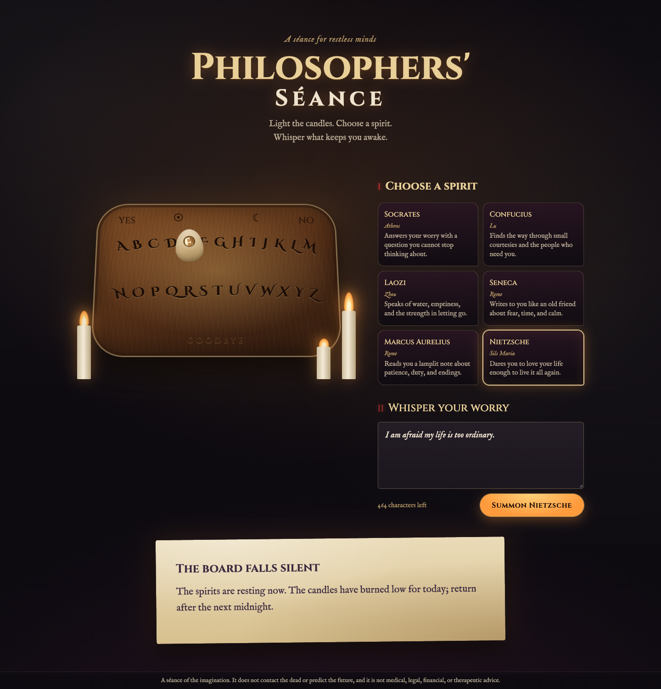
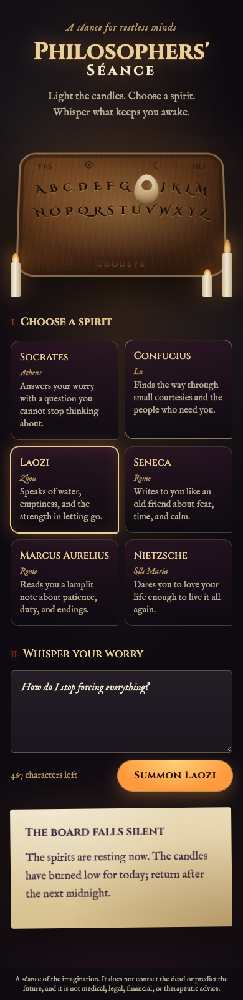

# Philosophers' Séance

Light the candles, choose a spirit, and whisper what keeps you awake. A long-dead philosopher answers through a candlelit spirit board.

Built for Kiroween (Costume Contest category). The haunted interface is the product: the planchette spells the summoned thinker's name, the candles gutter while the spirit thinks, and the answer arrives as spirit writing on old parchment.

| Desktop | Phone |
|---|---|
|  |  |

## The spirits

Only public-domain thinkers can be summoned: Socrates, Confucius, Laozi, Seneca, Marcus Aurelius and Nietzsche. Their personas are written from scratch for this project; no modern translation is quoted.

The séance is a work of imagination. It does not contact the dead or predict the future, and it is not medical, legal, financial or therapeutic advice.

## How it works

- **Front end**: static HTML, CSS and vanilla JavaScript modules. No build step.
- **Back end**: one serverless function, `api/seance.js`, that validates the request, enforces a daily call cap, and calls the Anthropic Messages API (`claude-haiku-5-5`).
- **Fail closed**: if `DAILY_CALL_LIMIT` is missing, empty or not a positive integer, every call is refused with `429 SPIRITS_RESTING` and the board tells the visitor the spirits are resting. The same happens once the day's cap is reached. A missing API key returns `503` without calling the model.

## Run locally

Requires Node 22.

```bash
npm install            # dev-only test dependencies
npm test               # node --test
ANTHROPIC_API_KEY=... DAILY_CALL_LIMIT=... node serve.mjs
```

Then open `http://127.0.0.1:3000`. `serve.mjs` is a development server only. Without a limit set, the board stays silent by design.

| Variable | Purpose |
|---|---|
| `ANTHROPIC_API_KEY` | Read from the environment only; never committed. |
| `DAILY_CALL_LIMIT` | Positive integer cap per UTC day. Empty or invalid blocks every call. |
| `PORT` | Local server port (dev only). |

## How Kiro was used

Everything under [`.kiro/`](.kiro) is the real working record:

- **Steering** (`.kiro/steering/`): `product.md`, `tech.md` and `tone.md` set the product scope, stack, security rules and the voice of the spirits.
- **Spec-driven development** (`.kiro/specs/seance-core/`): Kiro CLI in spec mode produced `requirements.md` (EARS acceptance criteria and correctness properties), `design.md` and the test-first `tasks.md`, then started executing the plan.
- **Agent hook** (`.kiro/hooks/run-tests-on-save.json`): runs `npm test` whenever a JavaScript file under `src/`, `api/` or `tests/` is saved.
- **Property-based testing**: the correctness properties in the spec are tested with `fast-check`.

## License

[MIT](LICENSE)
